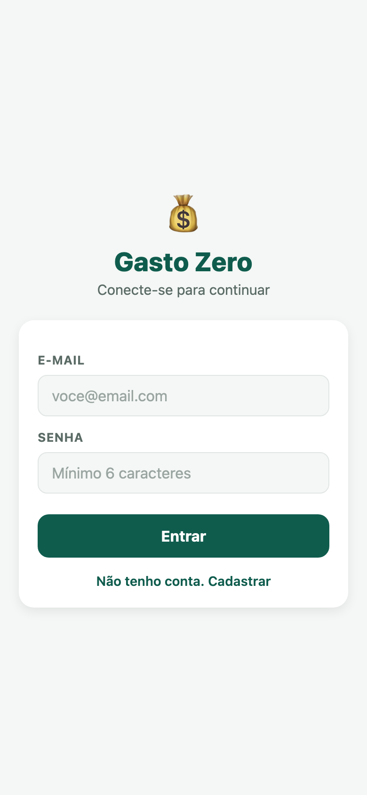
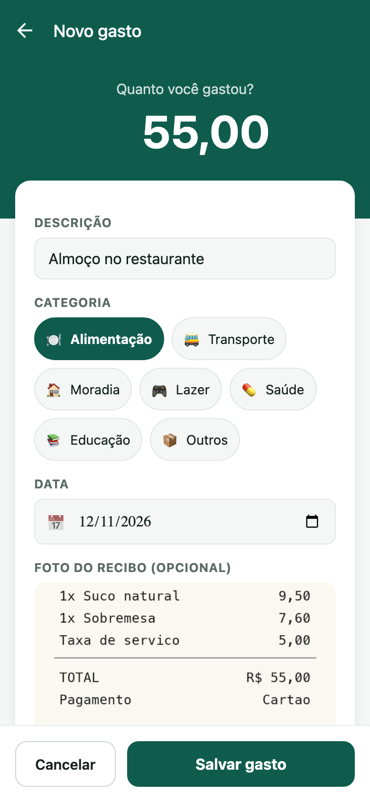
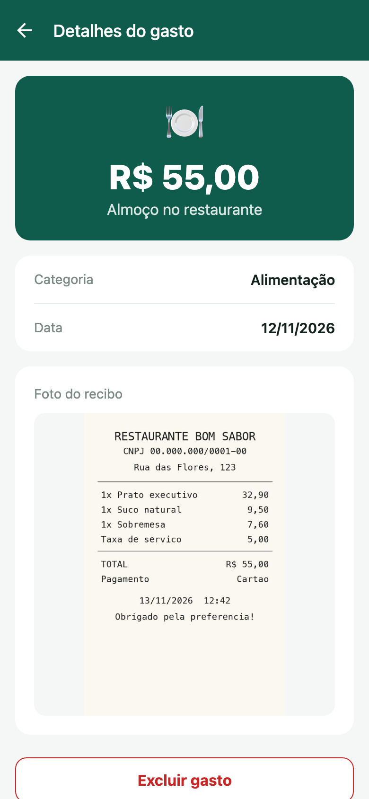
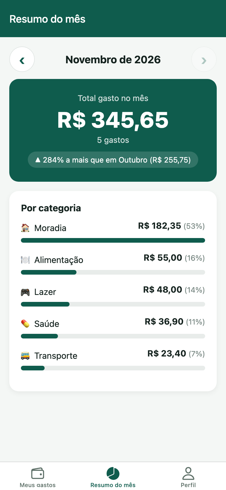
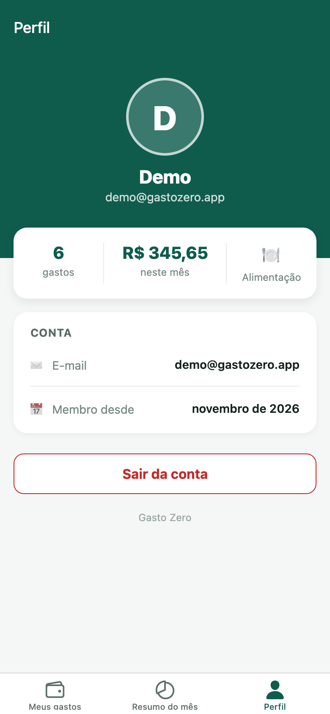

# GastoZero

Aplicativo de controle de gastos pessoais feito com **React Native + Expo** e **Firebase**.
O usuário cria uma conta, registra seus gastos com categoria, data e foto do recibo, e acompanha quanto gastou no mês.

---

## Integrantes

| Nome | GitHub | Responsabilidade |
|------|--------|------------------|
| Kaio Santos *(completar nome completo)* | [@KaioSantoss](https://github.com/KaioSantoss) | Base do projeto, tema e navegação |
| Ygor Farias de Melo | [@Yguin77](https://github.com/Yguin77) | Firebase: autenticação e CRUD |
| Denys Wenceslau *(completar nome completo)* | [@denyswenceslau1](https://github.com/denyswenceslau1) | Estado global e formulários |
| Gabriel Ataídes *(completar nome completo)* | [@ataidesgabrielsousa-cyber](https://github.com/ataidesgabrielsousa-cyber) | Componentes e telas (UI/UX) |
| Gustavo Simões Dantas | [@GustavoSimoesDantas](https://github.com/GustavoSimoesDantas) | Recursos nativos (data, câmera, haptics) e documentação |

---

## Funcionalidades

- **Login e cadastro** com e-mail e senha (Firebase Authentication)
- **Lista de gastos** do usuário, do mais recente para o mais antigo
- **Novo gasto** com valor, descrição, categoria, data e foto do recibo, com validação dos campos
- **Seletor de data** nativo (calendário do Android/iOS; na web, o calendário do navegador)
- **Foto do recibo** pela câmera ou pela galeria, comprimida antes de salvar
- **Feedback háptico**: vibração ao escolher categoria/data, ao anexar foto, ao salvar e em caso de erro
- **Detalhes do gasto** com a foto do recibo e opção de excluir
- **Resumo do mês**: total gasto, gasto por categoria e comparação com o mês anterior
- **Perfil** com estatísticas e botão de sair

---

## Prints

| Login | Meus gastos | Novo gasto |
|:---:|:---:|:---:|
|  |  |  |

| Detalhes | Resumo do mês | Perfil |
|:---:|:---:|:---:|
|  |  |  |

---

## Tecnologias

| Tecnologia | Uso |
|------------|-----|
| [Expo SDK 58](https://docs.expo.dev/) / React Native | Base do app (Android, iOS e web) |
| [React Navigation](https://reactnavigation.org/) | Navegação em pilha e abas |
| [Firebase Authentication](https://firebase.google.com/docs/auth) | Login com e-mail e senha |
| [Cloud Firestore](https://firebase.google.com/docs/firestore) | Banco de dados dos gastos |
| `@react-native-community/datetimepicker` | Seletor de data nativo |
| `expo-image-picker` | Câmera e galeria |
| `expo-image-manipulator` | Redimensionar e comprimir a foto do recibo |
| `expo-haptics` | Feedback háptico (vibração) |

---

## Estrutura de pastas

```
src/
├── components/   # Componentes reutilizáveis (SeletorData, FotoRecibo)
├── constants/    # Categorias de gasto
├── context/      # AuthContext (usuário logado)
├── navigation/   # Pilhas e abas de navegação
├── screens/      # Telas do app
├── services/     # Firebase: configuração, autenticação e CRUD de gastos
├── theme/        # Cores, espaçamentos e tipografia
└── utils/        # Validação de formulários e haptics
```

---

## Como rodar o projeto

**Pré-requisitos:** Node.js (versão LTS) e o app **Expo Go** (SDK 58) no celular, na mesma rede Wi-Fi do computador.

```bash
git clone https://github.com/KaioSantoss/gasto-zero0.git
cd gasto-zero0
npm install
```

Crie o arquivo `.env` na raiz do projeto com as chaves do Firebase (modelo em `.env.example`).
As chaves são passadas pelo grupo em mensagem privada e **nunca** devem ir para o GitHub.

```
EXPO_PUBLIC_FIREBASE_API_KEY=
EXPO_PUBLIC_FIREBASE_AUTH_DOMAIN=
EXPO_PUBLIC_FIREBASE_PROJECT_ID=
EXPO_PUBLIC_FIREBASE_STORAGE_BUCKET=
EXPO_PUBLIC_FIREBASE_MESSAGING_SENDER_ID=
EXPO_PUBLIC_FIREBASE_APP_ID=
```

Inicie o app:

```bash
npx expo start -c        # depois escaneie o QR code com o Expo Go
npx expo start --web     # para abrir no navegador
```

### Problemas comuns

| Erro | Solução |
|------|---------|
| Tela branca / `auth/invalid-api-key` | Falta o `.env` ou ele está incompleto. Depois de criar, rode `npx expo start -c` |
| `Unable to resolve module` | `npx expo start -c` |
| Versão incompatível no Expo Go | `npx expo install --fix` |
| Celular não conecta | `npx expo start --tunnel` |
| Porta 8081 ocupada | `npx expo start --port 19006` |

---

## Fluxo de trabalho (Git Flow)

- `main`: versão final
- `develop`: integração das funcionalidades
- `feature/*`: uma branch por integrante

Cada funcionalidade entra na `develop` por **Pull Request**, com revisão de outro integrante.
Commits seguem o padrão `feat:`, `fix:`, `docs:`, `style:`, `refactor:` e `chore:`.

---

## Licença

Distribuído sob a licença MIT. Veja [LICENSE](LICENSE).
